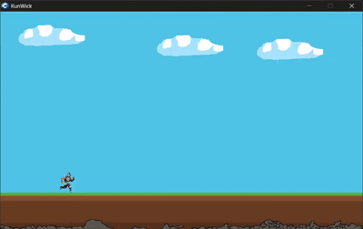

# cpp-runwick
### An endless platformer game created using C++ and SDL3 🎮

**RUNWICK** or [*Run While I Can*] is a platformer designed to be efficient and lightweight, it's fast, and frame independent (delta time) used, but also have a option to limit FPS, featuring jump, random enemies(fly/ground)

> [!NOTE]
> In Development (WIP)
> 
